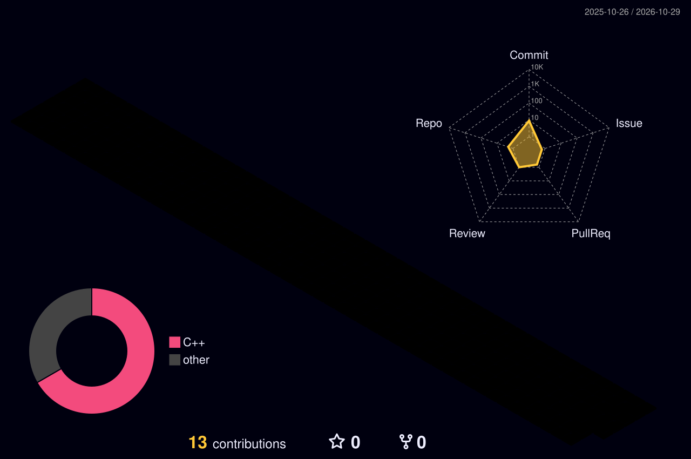

# Hi, my name is Liam 👋

## A self-taught, passionate developer, especially interested in the backend.
Since a *very* young age, I've been fascinated by how computers work. It took me until my early teens to really dive into it. I began with simple systems and rudimentary small projects, and continued developing until I understood modularity, architecture, and system design. Approximately last year I picked up C / C++ development, implementing a custom Steam CM client using an event / command dispatch architecture, backed by a connections interface.

  
  
  

## My Technologies

## Learning

    <picture>
    <source media="(prefers-color-scheme: dark)" srcset="github-snake-dark.svg" />
    <source media="(prefers-color-scheme: light)" srcset="github-snake.svg" />
    
    </picture>

	<picture>
	  
	</picture>

